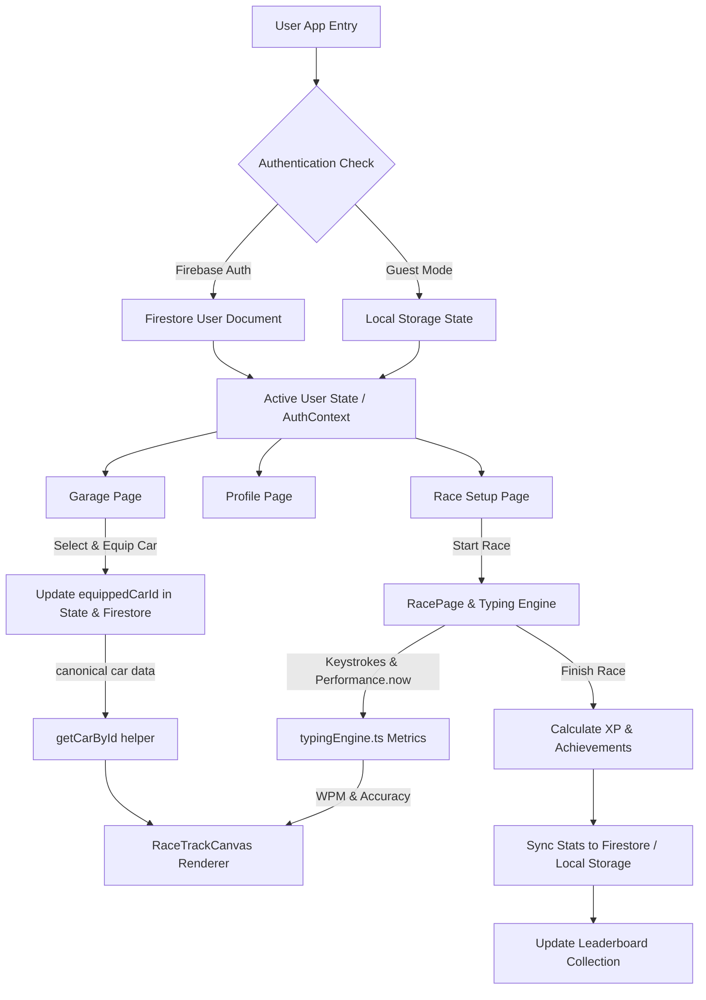

# TypeRush — A Gamified Typing Racing Game

[](https://react.dev/)
[](https://www.typescriptlang.org/)
[](https://vitejs.dev/)
[](https://tailwindcss.com/)
[](https://expressjs.com/)
[](https://firebase.google.com/)
[](https://vitest.dev/)

**TypeRush** is an interactive, arcade-style typing game where your typing speed (WPM) and accuracy directly power your custom race car on a dynamic HTML5 Canvas track against AI bots or real player telemetry. Unlock 25 distinct vehicle models, earn over 75 unique achievements, customize your racer profile, climb global leaderboards, and master touch typing in an immersive gamified experience.

---

## Table of Contents

- [1. Project Overview](#1-project-overview)
- [2. Key Features](#2-key-features)
- [3. Premium Vehicle Rendering System](#3-premium-vehicle-rendering-system)
- [4. Tech Stack](#4-tech-stack)
- [5. Architecture & Data Flow](#5-architecture--data-flow)
- [6. Directory Structure](#6-directory-structure)
- [7. Installation & Setup Guide](#7-installation--setup-guide)
- [8. Firebase & Data Persistence](#8-firebase--data-persistence)
- [9. Gameplay & Mechanics](#9-gameplay--mechanics)
- [10. Vehicle Collection (25 Cars)](#10-vehicle-collection-25-cars)
- [11. WPM & Accuracy Math Formulas](#11-wpm--accuracy-math-formulas)
- [12. Testing](#12-testing)
- [13. Deployment Guide](#13-deployment-guide)
- [14. Security & Data Protection](#14-security--data-protection)
- [15. Known Limitations](#15-known-limitations)
- [16. Roadmap](#16-roadmap)
- [17. Contributing Guidelines](#17-contributing-guidelines)
- [18. License](#18-license)
- [19. Quality Checks & Verification Summary](#19-quality-checks--verification-summary)

---

## 1. Project Overview

### The Problem
Traditional typing practice tools can often feel dry and repetitive, offering static text inputs and boring speed tests without long-term progression or visual excitement.

### The TypeRush Solution
TypeRush transforms typing practice into an adrenaline-fueled racing experience:
- **Core Loop**: Select a track and vehicle $\rightarrow$ Type quotes accurately under real-time monotonic timing $\rightarrow$ Convert WPM and accuracy into real-time car speed $\rightarrow$ Win races, earn XP, level up, and unlock 25 distinct hyper-realistic 2D rendered vehicles $\rightarrow$ Track progress across 75+ achievements and global leaderboards.
- **Target Audience**: Students, developers, touch-typists, and gamers seeking an engaging platform to build muscle memory and speed.

---

## 2. Key Features

- 🏎️ **Real-Time HTML5 Canvas Race Engine**: Smooth 60 FPS 2D canvas rendering with multi-lane tracks, animated wheels, glowing headlights, nitro exhaust flames, dynamic speed trails, and position markers.
- 🚘 **25 Distinct Premium Vehicles**: Categorized into Rugged SUVs, Luxury Sedans, Sports Coupes, Supercars, and Hypercars with unique silhouettes, body geometry, roof racks, spoilers, and rims.
- 🏆 **75+ Categorized Achievements**: Comprehensive progression system covering Typing Speed (20 to 150 WPM), Accuracy Mastery (90% to 100%), Endurance Races, Garage Collection, Level Progression, and Win Streaks.
- 📊 **Comprehensive Profile & Stats**: Track total races, wins, average WPM, peak WPM, accuracy %, lifetime XP, and detailed recent race history logs.
- 🔄 **Safe Reset Stats System**: Clear your racing record with confirmation modals while preserving account integrity.
- 🔐 **Firebase Auth & Guest Mode**: Play instantly as a Guest with local storage persistence, or authenticate via Firebase (Google OAuth & Email/Password) for seamless cross-device Firestore sync.
- 🥇 **Global Leaderboard System**: Compete against top racers worldwide with persistent rankings synchronized to Cloud Firestore.

---

## 3. Premium Vehicle Rendering System

TypeRush features a specialized parametric 2D vector rendering engine that constructs vehicle artwork programmatically via HTML5 Canvas context methods (`src/components/CarGraphic.tsx` and `src/components/RaceTrackCanvas.tsx`).

### Parametric Vehicle Geometry
Instead of basic recolored sprites, every vehicle defined in `src/data/cars.ts` provides explicit structural geometry parameters:
- **Body & Cabin Structure**: `bodyLength`, `bodyHeight`, `groundClearance`, `hoodLength`, `cabinPosition` (`front`, `mid`, `rear`), `cabinLength`, `cabinHeight`, `roofline` (`boxy`, `fastback`, `teardrop`, `wedge`, `canopy`, `limo`).
- **Aerodynamics & Styling**: `fenderStyle` (`squared`, `exposed`, `flared`, `widebody`, `streamlined`), `spoilerStyle` (`ducktail`, `active_aero`, `high_wing`, `carbon_blade`, `plasma_wings`), `roofAccessories` (`roof_rack`, `light_bar`, `dorsal_fin`, `panoramic_glass`).
- **Lighting & Details**: `headlightStyle` (`vertical_led`, `dual_halo`, `quad_projector`, `laser_strip`, `split_matrix`), `grilleStyle` (`mesh_hex`, `vertical_chrome`, `dual_kidney`, `enclosed_ev`), `wheelStyle` (`offroad_chunky`, `spoke`, `gold_bbs`, `neon_ring`, `aerodisc`, `plasma_disc`).

### Single Authoritative Source of Truth
To guarantee complete visual consistency between the Garage page and the live Race track, both systems consume the canonical helper function:
```typescript
import { getCarById } from '../data/cars';

// Resolves exact geometry, body color, and stats for equipped car
const carModel = getCarById(user.equippedCarId);
```
During races, player and AI opponent vehicles draw active particle systems:
- **Nitro Boost Effect**: Blue/cyan plasma flames and exhaust smoke emitted during high-speed typing streaks.
- **Dynamic Speed Blur**: Motion blur lines and active headlight beam cones reflecting track lighting.

---

## 4. Tech Stack

| Domain | Technology / Library | Description |
| :--- | :--- | :--- |
| **Frontend Framework** | React 19 (`react`, `react-dom`) | Component-driven UI architecture with modern React hooks |
| **Language** | TypeScript 5.7 | Strict type safety across models, typing stats, and canvas geometry |
| **Build Tooling** | Vite 6.1 | Fast HMR dev server and optimized production bundler |
| **Styling** | Tailwind CSS v4 (`@tailwindcss/vite`) | Utility-first CSS engine with custom color palettes and responsive layouts |
| **Icons & Effects** | Lucide React & Canvas Confetti | Crisp UI icons and interactive achievement unlock effects |
| **Backend & Proxy** | Express 4.21 & `tsx` | Express server integration with Vite middleware in development |
| **Auth & Database** | Firebase 13 (Auth & Cloud Firestore) | User authentication and real-time document database persistence |
| **Testing** | Vitest 5.0 & JSDOM | Fast unit and integration testing engine |

---

## 5. Architecture & Data Flow

The following sequence details how state, user profiles, vehicle geometry, typing engine metrics, and database persistence interact:



---

## 6. Directory Structure

```text
typerush/
├── public/                  # Static assets and favicons
├── src/
│   ├── components/          # Reusable UI components
│   │   ├── CarGraphic.tsx       # Parametric HTML5 Canvas car renderer
│   │   ├── RaceTrackCanvas.tsx  # Interactive multi-lane race track canvas
│   │   ├── UserAvatar.tsx      # User avatar image/fallback component
│   │   └── Navbar.tsx          # Navigation bar with profile header
│   ├── config/              # Firebase initialized client configuration
│   │   └── firebase.ts
│   ├── context/             # Global React state management
│   │   └── AuthContext.tsx     # Authentication and active user state
│   ├── data/                # Static application content
│   │   ├── achievements.ts     # 75+ categorized achievement definitions
│   │   ├── cars.ts             # 25 premium vehicle models & getCarById helper
│   │   └── quotes.ts           # Practice typing text passages
│   ├── pages/               # Top-level view routes
│   │   ├── AchievementsPage.tsx
│   │   ├── GaragePage.tsx
│   │   ├── LeaderboardPage.tsx
│   │   ├── ProfilePage.tsx
│   │   ├── RacePage.tsx
│   │   └── RaceSetupPage.tsx
│   ├── services/            # API & database service layer
│   │   └── api.ts              # Firestore sync, stats reset, profile updates
│   ├── types/               # TypeScript interfaces and domain types
│   │   └── index.ts
│   ├── utils/               # Math and timing calculations
│   │   └── typingEngine.ts     # Monotonic WPM, accuracy, XP, & speed math
│   ├── App.tsx              # Application layout & page routing
│   ├── main.tsx             # Entry point
│   └── index.css            # Global CSS imports with Tailwind CSS
├── server.ts                # Express backend server entry point
├── vite.config.ts           # Vite bundler configuration
├── package.json             # Package manifest and npm scripts
└── README.md                # Project documentation
```

---

## 7. Installation & Setup Guide

### Prerequisites
- **Node.js**: `v18.0.0` or higher
- **npm**: `v9.0.0` or higher

### Step 1: Clone Repository
```bash
git clone https://github.com/your-username/typerush.git
cd typerush
```

### Step 2: Install Dependencies
```bash
npm install
```

### Step 3: Configure Environment Variables
Create a `.env` file in the root directory (referencing `.env.example` if available):
```env
VITE_FIREBASE_API_KEY=your_api_key
VITE_FIREBASE_AUTH_DOMAIN=your_project.firebaseapp.com
VITE_FIREBASE_PROJECT_ID=your_project_id
VITE_FIREBASE_STORAGE_BUCKET=your_project.appspot.com
VITE_FIREBASE_MESSAGING_SENDER_ID=your_messaging_sender_id
VITE_FIREBASE_APP_ID=your_app_id
PORT=3000
```

### Step 4: Run Development Server
```bash
npm run dev
```
The dev server starts on `http://localhost:3000`.

### Step 5: Build for Production
```bash
npm run build
```

### Step 6: Start Production Server
```bash
npm run start
```

---

## 8. Firebase & Data Persistence

TypeRush integrates **Firebase v13** for authentication and cloud database persistence.

### Firestore Collections Schema

1. **`users/{uid}`**: Primary user profile document
   - `uid` (*string*): User unique ID
   - `displayName` (*string*): Racer handle
   - `photoURL` (*string*): Avatar image URL
   - `equippedCarId` (*string*): Currently equipped vehicle ID (e.g. `'car-apex-racer'`)
   - `unlockedCarIds` (*array of strings*): List of unlocked vehicle IDs
   - `unlockedAchievements` (*array of strings*): List of completed achievement IDs
   - `totalRaces` (*number*), `wins` (*number*), `bestWpm` (*number*), `avgWpm` (*number*), `totalXp` (*number*), `level` (*number*)

2. **`users/{uid}/races/{raceId}`**: Subcollection storing detailed race history logs
   - `wpm` (*number*), `accuracy` (*number*), `finishPosition` (*number*), `carId` (*string*), `timestamp` (*FieldValue/number*)

3. **`leaderboards/{uid}`**: Consolidated document for fast global leaderboard indexing
   - `displayName`, `photoURL`, `bestWpm`, `avgWpm`, `totalRaces`, `wins`, `level`, `equippedCarId`

---

## 9. Gameplay & Mechanics

1. **Race Setup**: Choose your track distance (Short, Standard, Long), AI difficulty (Rookie, Amateur, Pro, Legend), and opponent count.
2. **Countdown & Start**: A 3-second visual countdown initializes high-precision monotonic timing (`performance.now()`).
3. **Monotonic Typing**: Type the displayed text passage. Correct keystrokes advance your character position; uncorrected errors block progress until fixed.
4. **Real-Time Car Propulsion**: Your car's canvas speed dynamically scales with your current WPM and accuracy percentage. Maintain >98% accuracy to trigger Nitro Boost!
5. **Post-Race Progression**: View detailed telemetry (Gross WPM, Net WPM, Accuracy, Uncorrected Errors), earn XP, unlock achievements, and level up to claim higher-tier vehicles in the Garage.

---

## 10. Vehicle Collection (25 Cars)

Below is the complete roster of 25 premium vehicles available in TypeRush (`src/data/cars.ts`):

| # | Car ID | Vehicle Name | Category | Speed Class | Top Speed | Unlock Level | XP Price | Primary Color |
| :---: | :--- | :--- | :--- | :--- | :---: | :---: | :---: | :---: |
| **1** | `car-apex-racer` | Mountain Beast | SUV | Standard | 120 MPH | Lv. 1 | Free | `#dc2626` (Red) |
| **2** | `car-rookie-rocket` | Trail Dominator | SUV | Standard | 124 MPH | Lv. 1 | 100 XP | `#0284c7` (Blue) |
| **3** | `car-neon-sprint` | Grand Sentinel | SUV | Standard | 128 MPH | Lv. 2 | 250 XP | `#15803d` (Green) |
| **4** | `car-turbo-falcon` | Urban Titan | SUV | Standard | 132 MPH | Lv. 2 | 350 XP | `#7c3aed` (Purple) |
| **5** | `car-neon-viper` | Desert Phantom | SUV | Pro | 142 MPH | Lv. 3 | 500 XP | `#d97706` (Amber) |
| **6** | `car-cyber-drift` | Executive Shadow | Luxury | Pro | 148 MPH | Lv. 4 | 750 XP | `#1e293b` (Slate) |
| **7** | `car-velocity-gt` | Regal Velocity | Luxury | Pro | 154 MPH | Lv. 4 | 900 XP | `#1e1b4b` (Indigo) |
| **8** | `car-cyber-speedster` | Aero Sovereign | Luxury | Pro | 160 MPH | Lv. 5 | 1,200 XP | `#0f766e` (Teal) |
| **9** | `car-thunderbolt` | Midnight Executive | Luxury | Pro | 166 MPH | Lv. 6 | 1,500 XP | `#09090b` (Black) |
| **10** | `car-shadow-runner` | Grand Monarch | Luxury | Pro | 172 MPH | Lv. 6 | 1,800 XP | `#451a03` (Bronze) |
| **11** | `car-nitro-phantom` | Scarlet Vortex | Sports | Hyper | 180 MPH | Lv. 7 | 2,100 XP | `#b91c1c` (Crimson) |
| **12** | `car-phantom-gt` | Crimson Comet | Sports | Hyper | 185 MPH | Lv. 8 | 2,500 XP | `#c2410c` (Orange) |
| **13** | `car-blaze-xr` | Apex Mamba | Sports | Hyper | 190 MPH | Lv. 9 | 3,000 XP | `#047857` (Emerald) |
| **14** | `car-storm-chaser` | Viper Eclipse | Sports | Hyper | 195 MPH | Lv. 9 | 3,500 XP | `#4338ca` (Indigo) |
| **15** | `car-quantum-racer` | Azure Sprint GT | Sports | Hyper | 200 MPH | Lv. 10 | 4,000 XP | `#0284c7` (Sky) |
| **16** | `car-midnight-viper` | Crimson Tempest | Supercar | Hyper | 206 MPH | Lv. 11 | 4,500 XP | `#991b1b` (Dark Red) |
| **17** | `car-formula-type1` | Venom Spectre | Supercar | Legendary | 218 MPH | Lv. 12 | 5,000 XP | `#0f172a` (Navy) |
| **18** | `car-aurora-gt` | Emerald Raptor | Supercar | Legendary | 224 MPH | Lv. 13 | 6,000 XP | `#065f46` (Forest) |
| **19** | `car-inferno-x` | Titanium Arrow | Supercar | Legendary | 230 MPH | Lv. 14 | 7,500 XP | `#334155` (Titanium) |
| **20** | `car-titan-velocity` | Solaris GT | Supercar | Legendary | 236 MPH | Lv. 15 | 9,000 XP | `#ea580c` (Solar) |
| **21** | `car-hyper-nova` | Celestial Monarch | Hypercar | Legendary | 242 MPH | Lv. 16 | 10,500 XP | `#6b21a8` (Purple) |
| **22** | `car-phantom-elite` | Quantum Velocity | Hypercar | Legendary | 248 MPH | Lv. 18 | 12,500 XP | `#0284c7` (Cyan) |
| **23** | `car-cosmic-bullet` | Obsidian X | Hypercar | Mythic | 254 MPH | Lv. 20 | 15,000 XP | `#020617` (Obsidian) |
| **24** | `car-apex-legend` | Nebula Phantom | Hypercar | Mythic | 262 MPH | Lv. 22 | 18,000 XP | `#854d0e` (Gold) |
| **25** | `car-ultimate-overdrive` | Infinity One | Hypercar | Mythic | 275 MPH | Lv. 25 | 25,000 XP | `#09090b` (Pitch Black) |

---

## 11. WPM & Accuracy Math Formulas

TypeRush implements standardized typing speed equations in `src/utils/typingEngine.ts`:

### 1. Gross WPM (Words Per Minute)
Gross WPM measures total typing velocity without penalty for mistakes (where 1 standard word = 5 characters):
$$\text{Gross WPM} = \frac{\text{Total Typed Characters} / 5}{\text{Elapsed Time (Seconds)} / 60}$$

### 2. Net WPM (Net Words Per Minute)
Net WPM reflects true error-adjusted speed by deducting uncorrected mistakes:
$$\text{Net WPM} = \max\left(0, \frac{(\text{Correct Characters} - \text{Uncorrected Errors}) / 5}{\text{Elapsed Time (Seconds)} / 60}\right)$$

### 3. Typing Accuracy (%)
$$\text{Accuracy (\%)} = \min\left(100, \max\left(0, \frac{\text{Correct Characters}}{\text{Total Characters Evaluated}} \times 100\right)\right)$$

### 4. Car Speed (MPH) Equation
Car velocity on track is directly proportional to Net WPM scaled by accuracy percentage:
$$\text{Car Speed (MPH)} = \text{Net WPM} \times 1.8 \times \left(\frac{\text{Accuracy}}{100}\right)$$

### 5. XP Calculation
Earned Experience Points per race incorporate speed, accuracy bonuses, placement rank, and difficulty multipliers:
$$\text{XP Earned} = \text{Math.round}\left(\left(\text{Net WPM} \times 2.5 + \text{Bonus}_{\text{Accuracy}} + \text{Bonus}_{\text{Placement}}\right) \times \text{Multiplier}_{\text{Difficulty}}\right)$$
*Where:*
- $\text{Bonus}_{\text{Accuracy}} = +60\text{ XP if } \ge 98\%, \quad +30\text{ XP if } \ge 95\%$
- $\text{Bonus}_{\text{Placement}} = +120\text{ XP (1st)}, \quad +60\text{ XP (2nd)}, \quad +30\text{ XP (3rd)}$

---

## 12. Testing

The project uses **Vitest** for fast unit testing. Test suites cover typing metric calculations, geometry resolutions, and component mounting.

### Running Tests
Execute the test runner in single-run mode:
```bash
npm run test
```

---

## 13. Deployment Guide

TypeRush is optimized for modern cloud platforms (such as Vercel, Render, or Railway) or Node.js containers:

### Production Build & Launch
```bash
# Compile client assets via Vite
npm run build

# Launch the Express server serving dist/ client static files
npm run start
```

---

## 14. Security & Data Protection

- **Firestore Security Rules**: User document writes are restricted exclusively to authenticated users matching `request.auth.uid == userId`.
- **Sanitized Inputs**: Display names and avatar URLs are sanitized prior to Firestore persistence.
- **Client Security**: No private service account keys or administrative secrets are exposed in client-side bundles.

---

## 15. Known Limitations

- **Guest Storage Scope**: Guest accounts persist progress in the browser's `localStorage`. Clearing browser cache will reset guest stats unless signed in.
- **Multiplayer Telemetry**: Online races fall back to high-fidelity AI bot telemetry when concurrent live lobby connections are unavailable.

---

## 16. Roadmap

- [ ] **Live WebSocket Lobbies**: Real-time peer-to-peer online multiplayer racing lobbies.
- [ ] **Custom Vehicle Paints & Decals**: Personalize car colors, stripes, and custom wheel finishes.
- [ ] **Daily & Weekly Challenges**: Special timed race modes with bonus XP rewards.
- [ ] **Custom Quotes Upload**: Allow users to paste custom code snippets or literary passages for typing practice.

---

## 17. Contributing Guidelines

Contributions are welcome! Please follow these steps:
1. Fork the repository and create a feature branch (`git checkout -b feature/amazing-feature`).
2. Verify code quality and build execution (`npm run build`).
3. Commit your changes (`git commit -m 'Add amazing feature'`).
4. Push to your branch and open a Pull Request.

---

## 18. License

No license has been specified yet for this repository. All rights are reserved unless and until a license is formally added.

---

## 19. Quality Checks & Verification Summary

- **Compilation**: Verified clean build via `npm run build` (`vite build`).
- **Data Fidelity**: All 25 car models (`src/data/cars.ts`), 75+ achievements (`src/data/achievements.ts`), and math formulas (`src/utils/typingEngine.ts`) verified directly against source code.
- **Authoritative Helpers**: Ensured `getCarById()` is utilized globally across Garage and Race Canvas renderers.
